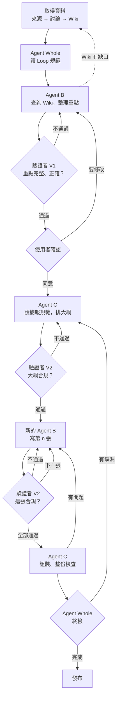

# 怎麼做出一個用到 LLM 的 OR 系統：LLM Wiki × 多代理人 Loop

這個專案用 LLM Wiki 整理 6 篇「LLM 幫忙做作業研究（OR）」的論文，再用一個多代理人 Loop，只拿 Wiki 當知識來源，產生一份給完全新手的教學 HTML 簡報。

- **教學簡報：** <https://jayceonlin.github.io/llm-or-system-loop/slides/>
- **Loop 的完整規範：** [loop/LOOP.md](loop/LOOP.md)
- **實際執行紀錄：** [runs/2026-11-19-run-01/run-log.md](runs/2026-11-19-run-01/run-log.md)

---

## 一、Wiki 專案的目錄

### Repo 結構

```
README.md                    本文件：目錄、Loop 說明、試錯經驗、資料來源
sources/                     引用資料的來源：6 篇論文的資料卡（書目、網址、閱讀筆記）
wiki/                        引用的資料內容：由 LLM 整理、互相連結的 Wiki
prompts/
  slide-rules.md             生成簡報要遵循的 prompt
  verify-keypoints.md        驗證規範 V1：重點清單
  verify-slides.md           驗證規範 V2：大綱、單張投影片、整份簡報
loop/
  LOOP.md                    Loop 的完整設計：角色、graph、交接檔案、重試上限、完成條件
  agents/                    每個 agent 的 prompt：whole、b-keypoints、c-director、b-slide-writer
  check.py                   驗證者呼叫的程式檢查
slides/
  template.html              簡報外框（樣式、操作列）
  index.html                 組裝好的簡報網頁（GitHub Pages）
runs/<日期>-run-NN/           每次實際執行的紀錄：草稿、驗證報告、截圖、checks.jsonl、run-log.md
```

### Wiki 頁面

Wiki 照「做出一個 LLM × OR 系統」的流程組織，從 [wiki/index.md](wiki/index.md) 或 [wiki/overview.md](wiki/overview.md) 開始讀。

| 類別 | 頁面 | 內容 |
| --- | --- | --- |
| 總覽 | [overview.md](wiki/overview.md) | 系統的五站，每篇來源做到哪幾站 |
| 系統的五站 | [01 問題輸入](wiki/system/01-problem-input.md) | 從文字題整理出變數、目標、限制與數據 |
| | [02 建模](wiki/system/02-modeling.md) | 寫出決策變數、目標函數、限制式 |
| | [03 寫程式交給求解器](wiki/system/03-code-and-solver.md) | LLM 寫程式，計算交給求解器 |
| | [04 驗證與修正](wiki/system/04-verify-and-repair.md) | 執行、檢查、帶著錯誤重寫，以及這個回圈的極限 |
| | [05 解釋結果與 what-if](wiki/system/05-explain-and-whatif.md) | 把結果翻成白話，回答「如果改成這樣會怎樣」 |
| 跨站的主題 | [多代理人](wiki/topics/multi-agent.md) | 指揮者、彙整器、評估器怎麼分工 |
| | [另一條路：LLM 當最佳化器](wiki/topics/llm-as-optimizer.md) | OPRO 的做法與限制 |
| | [三種角色](wiki/topics/llm-roles.md) | 翻譯者、最佳化器、解說員 |
| | [怎麼評估](wiki/topics/evaluation.md) | 資料集錯誤率、兩種判斷對錯的方式 |
| | [訓練與資料合成](wiki/topics/training-and-data.md) | 讓 LLM 本身更會建模 |
| | [限制與設計建議](wiki/topics/risks-and-design.md) | 做系統時要注意什麼 |
| | [新手術語表](wiki/topics/glossary.md) | 自製的白話解釋 |
| 比較與範例 | [系統比較表](wiki/comparisons/systems.md) | 每個系統涵蓋哪幾站 |
| | [手搖飲範例](wiki/examples/tea-shop.md) | 自製範例，一題走完五站，附可執行程式 |
| 書目與紀錄 | [references.md](wiki/references.md)、[log.md](wiki/log.md) | 6 篇論文的書目；每次討論、整理與檢查的紀錄 |

每一頁的數字都標了來源 [S1]～[S6]，`loop/check.py lint` 會核對這些數字是否真的出現在對應的資料卡。

---

## 二、Loop 的流程設計

完整規範、每個 agent 的 prompt 與 graph 在 [loop/LOOP.md](loop/LOOP.md)，這裡是簡要說明。

### 五個步驟與負責的 agent

```
取得資料 → 查詢 Wiki → 整理重點 → 檢查內容 → 產生簡報
```

| 步驟 | 做什麼 | 誰做 |
| --- | --- | --- |
| 取得資料 | 讀 6 篇論文寫成資料卡，和使用者討論後生成 Wiki | Agent Whole＋使用者 |
| 查詢 Wiki | 讀 Wiki，找出要教的內容 | Agent B |
| 整理重點 | 寫成重點清單；再由 Agent C 排成大綱、為每張投影片寫任務單 | Agent B、Agent C |
| 檢查內容 | 重點清單、大綱、每一張投影片、整份簡報都要通過驗證 | 驗證者 V1、V2，加上程式檢查 |
| 產生簡報 | 每一張由一個新的 Agent B 照任務單撰寫，最後由 Agent C 組裝 | Agent B、Agent C |

**Agent Whole** 是整個 Loop 的領導者：先讀 Loop 規範，再指派 Agent B 整理重點、交給驗證者 V1；通過後請使用者確認，再指派 **Agent C**。Agent C 讀簡報的限制與工作需求、排大綱，再為每一張投影片指派一個新的 Agent B 撰寫，交給驗證者 V2；全部通過後組裝成整份簡報，回報 Agent Whole 做最後的完成確認。



### 哪些步驟會重複執行？

| 回圈 | 什麼時候重複 | 上限 |
| --- | --- | --- |
| 整理重點 ⇄ V1 | 重點清單漏了 Wiki 的觀念或講錯 | 3 次 |
| 排大綱 ⇄ V2 | 大綱的教學順序、份量或內容不合規 | 3 次 |
| 寫投影片 ⇄ V2 | 每一張各自重複，直到這一張通過 | 每張 3 次 |
| 整份檢查 → 寫投影片 | 組裝後發現跨張的問題或版面問題 | 2 次 |
| 整理重點 → 取得資料 | Wiki 缺少教學需要的內容 | 回到「先討論、後生成」 |

超過上限就停下來問使用者，不無限重試。

### 哪些地方需要檢查或重新生成？

- **Wiki 生成後：** `check.py lint` 檢查連結、目錄、孤兒頁，並核對每個數字是否出自引用的資料卡。
- **重點清單：** 程式檢查格式與每一頁都有被引用；V1 再逐頁對照，找出漏掉或講錯的觀念。
- **使用者確認：** 重點清單是整份簡報的地基，所以在這裡停下來給人看一次。
- **大綱：** 程式檢查教學結構、張數、字數、列點數、數字可追溯、每個重點都有分配到；V2 再檢查教學順序與任務單。
- **每一張投影片：** 程式檢查同樣的規則，並把這一張套進外框，量桌面與手機版面放不放得下；V2 再逐句對照 Wiki，確認沒有講錯、新術語有解釋。
- **整份簡報：** 程式檢查結構與重複，並在桌面與手機版截圖；V2 看截圖找出程式抓不到的版面問題，也檢查跨張的說法是否一致。

任何一關不通過，都是**開一個新的 agent 重新生成**，只給它任務單、規範與上一份驗證報告。

### 為什麼這樣設計？

1. **產生和驗證分開。** 寫的 agent 不驗收自己的東西。LLM 自己說「檢查過了」最不可靠，論文裡的系統也是這樣做，例如 Chain-of-Experts 的評估器本身不是 LLM。
2. **先跑程式，再讓驗證者判斷。** 數字、字數、版面這些規則交給程式，每次都一樣嚴格；完整不完整、有沒有講錯、新手看不看得懂，才交給驗證者。
3. **檢查越早越便宜。** 重點清單和大綱都先驗證，再開始寫投影片。在大綱改一行，比改好幾張 HTML 便宜。
4. **一張一張生成，一張一張驗證。** 每個 Agent B 只負責一張，錯了只要重寫那一張。重寫時是新的 agent，只會針對報告指出的問題修改。
5. **退回時附問題清單，並設上限。** 驗證報告寫明哪裡錯、為什麼、怎麼改，產生者才知道要改什麼；上限讓 Loop 不會無限重試。
6. **每一步都留檔。** 草稿、報告、程式檢查結果都存進 `runs/`，事後可以完整對照每一次失敗。

---

## 三、試錯經驗

原本我認為只要把 Loop 的流程畫清楚，再讓每個 agent 照規範去做，整份簡報應該就差不多完成了。但真正跑過一次後，我才發現大部分的時間都花在退回與重做，而退回的原因也常常出在 Wiki、規範或外框本身。下面是這次執行中最主要的幾次試錯，完整過程記在 [run-log.md](runs/2026-11-19-run-01/run-log.md)。

### 這次 run 實際退回的次數

| 節點 | 結果 |
| --- | --- |
| 取得資料與 Wiki lint | 第 1 次 8 個錯誤，其中 3 個是規則誤判；之後因為 Wiki 有缺口，回到這一步 2 次（術語表、書目） |
| 整理重點 ⇄ V1 | 3 版：第 1 版退回 2 項必須修，第 2 版通過，第 3 版照使用者確認時的意見修 2 個重點 |
| 排大綱 ⇄ V2 | 4 版：第 1 版 Whole 退回（書目），第 2 版退回 2 項必須修，第 3 版通過，第 4 版只改第 20 張 |
| 寫投影片 ⇄ V2 | 20 張共 34 份草稿，重寫 14 次；另有 8 張在外框修正後重新判定通過；03、04、08、13、17 從沒重做 |
| 整份檢查 | 3 次都判定通過，但前兩次的建議分別退回重寫 7 張、3 張，用滿 2 次上限 |
| 用量上限 | 一次開 10 個 Agent B 全部中斷，改成 5 張一批 |


### 程式抓不到意思上的錯

重點清單第 1 版的程式檢查是通過的，但驗證者 V1 讀過 Wiki 後，還是判定兩項必須修。其中一項是 Wiki 寫「不含求解器時間，每次都在 7 分鐘內完成」，Agent B 卻把不含求解器時間接到 token 數量上，而程式只比對數字有沒有出現，抓不到修飾語接錯地方。另一項是評估頁有兩種判斷對錯的方式，B 只寫了一種，但這一頁有被引用，所以完整度檢查也算它通過。

封面也有類似的狀況。B 用自己的話把 LLM 解釋成能讀懂文字、寫出文字的 AI，Wiki 其實沒有這個定義，程式也查不出來，是 V2 對照總覽頁後才退回。因此，我把檢查分成兩層，數字、字數與版面交給程式，講得對不對、新手看不看得懂則交給沒有參與撰寫的驗證者。

### Wiki 的缺口會讓 Loop 回到取得資料

Loop 跑到一半，有兩次是因為 Wiki 本身不夠而回到取得資料。第一次是 B 整理重點時發現，Wiki 用到 LP、token 與 API 呼叫等詞卻沒有白話解釋，Whole 把缺口交給我決定，我選擇加一頁自製術語表。

第二次是排大綱時，Agent C 為了通過數字要出自 Wiki 的規則，把資料來源那張的年份與 arXiv 編號全部刪掉，只剩論文簡稱。原因是書目只寫在資料卡，Wiki 裡沒有。這時候最快的做法是放寬規則，但我認為這是 Wiki 的缺口，因此先回到取得資料新增 references.md，再讓 C 重排那一張。

### 版面放到最後才量，20 張有 12 張放不下

原本的規範把版面檢查放在組裝之後，單張驗證只算字數、列點與數字。結果第 06 到 20 張的驗證者自己把草稿套進外框量版面時，才發現 15 張裡有 11 張放不下。我用舊外框重量全部 20 張，有 12 張超出畫面，最多超出 282px。

找原因後才發現，問題幾乎都在外框與規範，撰寫的 B 其實都照著任務單做。每張 180 字的上限配上 29px 的內文字級本來就放不下，回圈標記在手機上會超出畫面，頁尾顯示完整路徑時也一定會被截斷。因此，我先縮小外框的字級與間距，再把 render-slide 提前到每張撰寫與驗證時都要跑，讓版面問題在寫的當下就被發現。

### 單張都通過，放在一起看才有問題

20 張逐張驗證都通過後，整份檢查還是找到幾個放在一起看才會出現的問題。例如第 05、06 張各寫了一個第一名，分數卻不同，其實是兩個子任務，但投影片沒有說清楚。第 16、18 張用了 Wiki 沒有解釋的基礎模型，第 11 張的角色分站也和第 08、15 張對不上。

這些問題在單張驗證時看不出來，因為每個 V2 只看自己那一張。而這也是我保留整份檢查，並讓它可以退回撰寫步驟的原因。第 1 次整份檢查退回重寫了 7 張，之後再請 C 把大綱與任務單同步成新的寫法。

第 2 次整份檢查又找到兩個新手會卡住的地方。學習目標第一次出現 what-if 卻沒有解釋，整份簡報在書目之前也沒說 NL4Opt 是一場比賽。這兩項只是建議，但這份簡報的讀者就是新手，因此我再退回重寫 3 張，剛好用完兩次的上限，第 3 次整份檢查就通過了。

### 截圖看到的問題，寫成新的程式規則

整份檢查時，驗證者會看桌面與手機的截圖。手機上 what-if 與 Chain-of-Experts 在連字號的地方斷行，頁尾連結擠在一起被截斷，比較表也只看得到三欄，這些都是程式原本沒有抓到的。因此，我把連字號斷行寫成 render 的新規則，重量 20 張時正好抓到第 19、20 張。後來驗證者又指出，量版面前要先打開測驗的答案，桌面也要抓 ICLR 2024 這種會議名稱和年份被拆開，這些也都補進 render，之後每次組裝都會自動檢查。

### 子 agent 開太多，撞到用量上限

寫投影片時，我原本一次開 10 個 Agent B 同時撰寫，結果全部在剛開始就因為帳號的 5 小時用量上限中斷。原因是每個子 agent 都要從頭讀規範與 Wiki，前面整理重點與排大綱又已經開過 11 個。後來改成一次 5 張分批進行，V2 也改成一次驗一批，每張仍然各寫一份報告、各自判定。

另外，實際執行時子 agent 不能再開子 agent，因此 Agent C 沒辦法自己指派新的 Agent B。我的做法是讓 C 為每一張寫一份任務單，再由 Whole 所在的主對話照任務單開 B 與 V2，流程上的上下關係不變。

### 回頭看這次的設計

回頭看這次的執行，同一類錯誤重複出現時，通常代表要改的是 Wiki、規範或外框，再叫 B 重寫一次並不會解決。Loop 裡最有用的也不是哪一個 agent 寫得特別好，而是每一關都可以退回，而且退回時附上具體的問題。這次每一次失敗都留在 runs 資料夾，之後要調整 Loop 時，可以直接從這些紀錄找原因。下一次執行時，我希望先用幾張示範投影片量過外框，再決定每張的字數上限，讓版面問題不用等到寫完才被發現。

---

## 四、資料來源說明

### 6 篇論文

| 編號 | 書目 | 資料卡 |
| --- | --- | --- |
| S1 | Ziyang Xiao 等，“A Survey of Optimization Modeling Meets LLMs: Progress and Future Directions,” IJCAI 2025. [arXiv:2508.10047](https://arxiv.org/abs/2508.10047) | [S1](sources/S1-survey-2025.md) |
| S2 | Rindranirina Ramamonjison 等，“NL4Opt Competition: Formulating Optimization Problems Based on Their Natural Language Descriptions,” NeurIPS 2022 競賽報告. [arXiv:2303.08233](https://arxiv.org/abs/2303.08233) | [S2](sources/S2-nl4opt-2022.md) |
| S3 | Ali AhmadiTeshnizi、Wenzhi Gao、Madeleine Udell，“OptiMUS: Optimization Modeling Using MIP Solvers and large language models,” 2023；後續版本發表於 ICML 2024. [arXiv:2310.06116](https://arxiv.org/abs/2310.06116) | [S3](sources/S3-optimus-2023.md) |
| S4 | Ziyang Xiao 等，“Chain-of-Experts: When LLMs Meet Complex Operations Research Problems,” ICLR 2024. [論文頁](https://proceedings.iclr.cc/paper_files/paper/2024/hash/d45ee77826332c100a1e15f7765b99ff-Abstract-Conference.html) | [S4](sources/S4-chain-of-experts-2024.md) |
| S5 | Chengrun Yang 等，“Large Language Models as Optimizers,” Google DeepMind, 2023. [arXiv:2309.03409](https://arxiv.org/abs/2309.03409) | [S5](sources/S5-opro-2023.md) |
| S6 | Beibin Li 等，“Large Language Models for Supply Chain Optimization”（OptiGuide），Microsoft, 2023. [arXiv:2307.03875](https://arxiv.org/abs/2307.03875) | [S6](sources/S6-optiguide-2023.md) |

### 怎麼使用這些來源

- **資料卡只放書目與閱讀筆記。** 論文受著作權保護，`sources/` 只記下出處、版本、授權與用自己的話寫的重點，不轉載全文。
- **Wiki 的每個數字都標出處。** 句子裡的數字必須真的出現在它引用的資料卡，由 `check.py lint` 自動核對。
- **版本不一致時兩個都記。** 例如 OptiMUS 的進步幅度，v1 寫 67%，v2 寫「接近兩倍」，Wiki 兩個都寫並標明版本。
- **自製內容都有標明。** [手搖飲範例](wiki/examples/tea-shop.md)與[新手術語表](wiki/topics/glossary.md)不是來自論文，頁面與簡報上都寫明「自製」。
