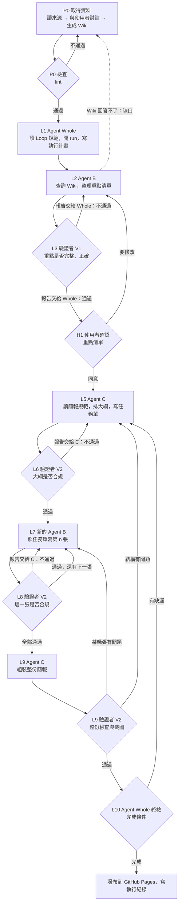

# Loop 設計：從 Wiki 到教學簡報

這份文件是整個 Loop 的規範。**Agent Whole 開始每一次執行前都要先讀完它**，再照它指派工作。各 agent 的完整 prompt 在 [`loop/agents/`](agents/)，生成簡報要遵循的規則在 [`prompts/slide-rules.md`](../prompts/slide-rules.md)，驗證規範在 [`prompts/verify-keypoints.md`](../prompts/verify-keypoints.md) 與 [`prompts/verify-slides.md`](../prompts/verify-slides.md)。

---

## 1. 角色

| 角色 | 是誰 | 負責 | 讀哪些規範 |
| --- | --- | --- | --- |
| Agent Whole | 主對話中的 AI，整個 Loop 的領導者 | 開 run、指派工作、判定重點清單、請使用者確認、最後終檢與發布 | 本文件、[agents/whole.md](agents/whole.md) |
| Agent B（重點整理） | 每次都開一個新的子 agent | 查詢 Wiki，整理成重點清單 | [agents/b-keypoints.md](agents/b-keypoints.md) |
| Agent C（簡報主管） | 子 agent | 讀簡報規範，排大綱、寫每張投影片的任務單；最後組裝整份並回報 Whole | [agents/c-director.md](agents/c-director.md)、[slide-rules](../prompts/slide-rules.md) |
| Agent B（投影片撰寫） | 每一張、每一次重做都開新的子 agent | 照任務單寫一張投影片 | [agents/b-slide-writer.md](agents/b-slide-writer.md)、[slide-rules](../prompts/slide-rules.md) |
| 驗證者 V1 | 獨立的子 agent | 驗證重點清單是否完整、正確 | [verify-keypoints](../prompts/verify-keypoints.md) |
| 驗證者 V2 | 獨立的子 agent | 驗證大綱、每一張投影片、整份簡報是否符合規範 | [verify-slides](../prompts/verify-slides.md) |
| 使用者 | 人 | 建 Wiki 前的討論；重點清單的確認 | |

**三個原則：**

1. **產生和驗證分開。** 寫東西的 agent 不能驗收自己的東西，驗證者也看不到產生者的思考過程，只看產出的檔案。
2. **驗證一定先跑程式，再做判斷。** 程式查得出來的（數字是否出自 Wiki、列點數、字數、版面）交給 [`loop/check.py`](check.py)；程式查不出來的（是否完整、是否講對、新手看不看得懂）才由驗證者判斷。
3. **交接全部用檔案。** 每一份產出、每一份驗證報告都存進 `runs/<run>/`，事後可以完整對照。

---

## 2. Graph



### 對應作業的五個步驟

| 作業的步驟 | 節點 |
| --- | --- |
| 取得資料 | P0 |
| 查詢 Wiki | L2（B 讀 Wiki 整理重點）、L7（B 只讀任務單指定的 Wiki 頁面） |
| 整理重點 | L2（重點清單）、L5（大綱） |
| 檢查內容 | P0 檢查、L3、H1、L6、L8、L9 驗證、L10 |
| 產生簡報 | L7（逐張產生）、L9（組裝） |

---

## 3. 每個節點的輸入與輸出

所有檔案都在 `runs/<run>/` 底下。

| 節點 | 執行者 | 讀 | 寫 |
| --- | --- | --- | --- |
| P0 | Whole＋使用者 | `sources/` | `wiki/`、`wiki/log.md` |
| L1 | Whole | 本文件 | `plan.md`：範圍、讀者、張數範圍、重試上限 |
| L2 | B（重點整理） | `plan.md`、`wiki/` | `attempts/keypoints-vK.md`；退回時另外讀上一份報告 |
| L3 | V1 | 重點清單、`wiki/` | `reports/keypoints-vK.json` |
| H1 | 使用者 | `keypoints.md` | 同意或修改意見，寫進 `run-log.md` |
| L5 | C | `keypoints.md`、slide-rules、`wiki/` | `attempts/outline-vK.md`、`tasks/NN.md` |
| L6 | V2 | 大綱、重點清單、`wiki/` | `reports/outline-vK.json` |
| L7 | B（投影片撰寫） | `tasks/NN.md`、slide-rules、任務單指定的 Wiki 頁面 | `attempts/NN-vK.html` |
| L8 | V2 | 這一張、任務單、Wiki 頁面；程式 `check-slide` 與 `render-slide` | `reports/NN-vK.json` |
| L9 | C、V2 | `slides/NN.html`、全部報告 | `slides/index.html`、`screens/`、`reports/deck-vK.json`、`report-to-whole.md` |
| L10 | Whole | 以上全部 | `run-log.md` 的終檢結果 |

通過的版本會複製成正式檔名：`keypoints.md`、`outline.md`、`slides/NN.html`。沒通過的版本留在 `attempts/`，不刪除。

---

## 4. 驗證報告的格式

V1、V2 每次都輸出同一種 JSON，退回時整份交給下一個產生者：

```json
{
  "target": "attempts/05-v1.html",
  "verdict": "fail",
  "program_check": { "command": "python3 loop/check.py check-slide ...", "errors": ["..."] },
  "issues": [
    { "level": "必須修", "where": "第 2 個列點", "problem": "數字 92% 在 Wiki 是 92–93%", "fix": "改成 92–93%" }
  ],
  "summary": "一句話說明結論"
}
```

- `level` 只有「必須修」與「建議」兩種。
- **判定規則：** 程式檢查有任何錯誤，或有任何一項「必須修」，就是 `fail`；只有「建議」時是 `pass`。

---

## 5. 會重複的地方與上限

| 回圈 | 什麼時候重複 | 上限 |
| --- | --- | --- |
| P0 ⇄ P0 檢查 | lint 不通過 | 修到通過 |
| L2 ⇄ L3 | V1 判定不通過 | 3 次 |
| H1 → L2 | 使用者要求修改 | 照使用者意見 |
| L5 ⇄ L6 | V2 判定大綱不通過 | 3 次 |
| L7 ⇄ L8 | V2 判定這一張不通過；每一張各自計算 | 每張 3 次 |
| L9 → L7 或 L5 | 整份檢查發現某幾張或結構有問題 | 2 次 |
| L2 → P0 | B 發現 Wiki 缺少需要的內容 | 回到 P0 走一次「先討論、後生成」 |

**超過上限就停下來問使用者**，把最後一份報告和卡住的原因一起交給使用者，不無限重試。

每一次重做都是**新的 agent**，只拿到任務單、規範和上一份驗證報告，不拿上一個 agent 的對話內容。這樣它只會針對報告指出的問題修改，不會被上一次的想法帶著走。

---

## 6. 完成條件（L10）

Agent Whole 確認下面五項都成立，Loop 才算完成：

1. `keypoints.md` 通過 V1，且使用者已在 H1 同意。
2. 重點清單的每一個編號，都至少出現在一張投影片的 `data-points`。
3. 每一張投影片都有一份 `pass` 的 V2 報告。
4. 整份檢查通過：`check-slides` 與 `render` 沒有錯誤，V2 看過截圖。
5. `run-log.md` 記錄了每一次失敗、退回的原因與處理方式。

哪一項不成立，就退回對應的節點：第 1 項回 L2，第 2 項回 L5，第 3、4 項回 L7 或 L5，第 5 項由 Whole 補寫。

---

## 7. 實作說明

- **子 agent 不能再開子 agent。** 所以 Agent C 的「指派」寫成任務單 `tasks/NN.md`，由 Agent Whole 所在的主對話照任務單啟動新的 B 與 V2，報告放回 C 的資料夾 `reports/`。接受或退回只照第 4 節的判定規則，不由主對話自行判斷。
- **程式檢查：** `python3 loop/check.py <指令> --run runs/<run>`，結果自動附加到 `checks.jsonl`。指令說明在 [check.py](check.py) 開頭。
- **版面檢查提前到 L8：** run-01 原本只在 L9 量版面，結果 20 張裡有 12 張在組裝前就放不下。現在 B 寫完、V2 驗證時都要跑 `render-slide`，把單張套進外框實際量版面。
- **組裝：** 投影片只寫 `<section>` 本身，頁尾的 Wiki 連結由 `check.py build` 依 `data-wiki` 自動產生，外框、樣式與操作列都在 [`slides/template.html`](../slides/template.html)。
- **用量：** 每個子 agent 都要從頭讀規範與 Wiki，同時開太多會撞到帳號的用量上限（run-01 實際發生過）。所以 L7 一次最多 5 張分批進行；L8 可以由一個 V2 一次驗一批，但每張仍各自寫一份報告、各自判定，產生與驗證仍然分開。
- **紀錄：** Whole 在 `run-log.md` 寫每個節點的經過；程式檢查自動寫進 `checks.jsonl`；所有草稿與報告留在 `attempts/`、`reports/`。
